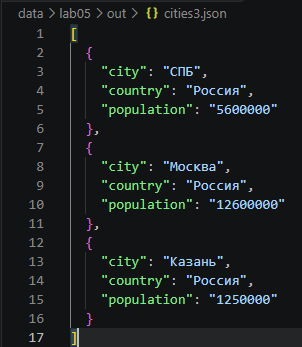
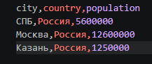
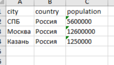
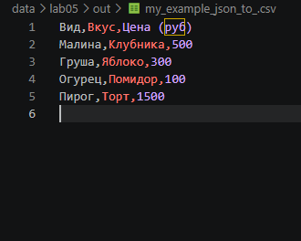
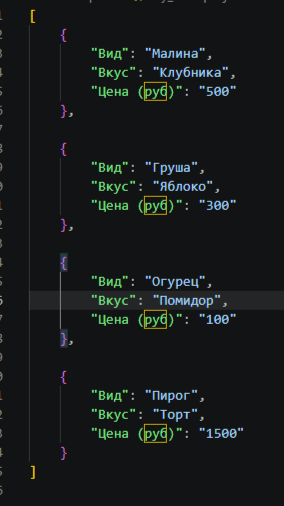

# ЛР5 — JSON и конвертации (JSON↔CSV, CSV→XLSX): Техническое задание
# Задание А — JSON ↔ CSV : модуль src/lab05/json_csv.py
# Функция json_to_csv
``` python
def json_to_csv(json_path: str, csv_path: str) -> None:
    """
    Преобразует JSON-файл в CSV.
    Поддерживает список словарей [{...}, {...}], заполняет отсутствующие поля пустыми строками.
    Кодировка UTF-8. Порядок колонок — как в первом объекте.
    """
    json_f=Path(json_path)
    csv_f=Path(csv_path)
    
    
    if not json_f.exists():
        raise FileNotFoundError("файл не найден")
    if json_f.suffix.lower() != ".json":
        raise ValueError('Входной файл должен быть JSON')
    if csv_f.suffix.lower() != ".csv":
        raise ValueError("Входной файл должен быть CSV")
    
    
    with json_f.open ("r",encoding='UTF-8') as f:
        try:
            data = json.load(f)
        except json.JSONDecodeError:
            raise ValueError("Пустой JSON / неподдерживаемая структура")
        
    if not isinstance(data, list) or len(data) == 0:
        raise ValueError('Файл JSON пустой / имеет неправильный формат')
    if not all(isinstance(i, dict) for i in data):
        raise ValueError("Все элементы списка JSON должны быть словарями")
    
    fieldnames = {}
    for element in data:
        for key in element.keys():
            fieldnames[key] = None

    with csv_f.open('w', newline="", encoding='utf-8') as f:
        w = csv.DictWriter(f, fieldnames=list(fieldnames.keys()))
        w.writeheader()
        w.writerows(data)

``` 
Для запуска :

``` python
python -m src.lab05.json_csv
python -m src.lab05.csv_xlsx

``` 

Работа функции:
1. **Валидация ошибок.** Отслеживает `FileNotFoundError` (файла нет) и `ValueError` (неверное расширение, пустой JSON или неподходящая структура данных).
2. **Нормализация путей.** Преобразует строковые пути в объекты `Path` для безопасной и удобной работы с файловой системой.
3. **Десериализация.** Читает JSON-файл и преобразует его содержимое в Python-объект (список словарей).
4. **Проверка структуры.** Убеждается, что данные — это непустой список, и что все его элементы являются словарями.
5. **Сбор заголовков.** Формирует единый словарь ключей (заголовков), проходя по всем объектам и запоминая порядок их первого появления.
6. **Запись в CSV.** Создает CSV-файл в кодировке UTF-8 и записывает данные через `csv.DictWriter`.
7. **Обработка пропусков.** Автоматически заполняет отсутствующие в словарях поля пустыми строками (`restval=""`).


# Функция csv_to_json
``` python
def csv_to_json(csv_path: str, json_path: str) -> None:
    """
    Преобразует CSV в JSON (список словарей).
    Заголовок обязателен, значения сохраняются как строки.
    json.dump(..., ensure_ascii=False, indent=2)
    """
    csv_fi=Path(csv_path)
    json_fi=Path(json_path)
    
    if not csv_fi.exists():
        raise FileNotFoundError("CSV Файл не найден")
    if csv_fi.suffix.lower() != ".csv":
            raise ValueError("Входной файл должен быть CSV")
    if json_fi.suffix.lower() != ".json":
        raise ValueError("Входной файл должен быть JSON")
    
    
    with csv_fi.open('r',encoding='UTF-8',newline='') as f:
        reader = csv.DictReader(f)
        if reader.fieldnames is None:
            raise ValueError("CSV не содержит заголовок")
        rows=list(reader)
        
        
        if len(rows) == 0:
            raise ValueError("В CSV не содержится данных")
        
        with json_fi.open("w", encoding="utf-8") as f:
            json.dump(rows, f, ensure_ascii=False, indent=2)
            
if __name__=='__main__':
    csv_to_json('data/lab05/samples/cities3.csv','data/lab05/out/cities3.json')
``` 
Для запуска:
``` python
python -m src.lab5.json_csv 
``` 

Работа функции:
1. **Валидация ошибок.** Отслеживает `FileNotFoundError` (файла нет) и `ValueError` (неверное расширение, отсутствие заголовка или данных в CSV).
2. **Нормализация путей.** Преобразует строковые пути в объекты `Path` для безопасной работы с файловой системой.
3. **Чтение заголовков.** Открывает CSV и использует `csv.DictReader`, который берет первую строку файла и превращает её в ключи (заголовки) будущих словарей.
4. **Проверка структуры.** Убеждается, что заголовок существует (`fieldnames is not None`), а также что в файле есть хотя бы одна строка с данными (список `rows` не пуст).
5. **Формирование данных.** Преобразует все прочитанные строки в список словарей, где ключи — это заголовки, а значения — строки данных.
6. **Запись в JSON.** Открывает файл в режиме записи (`"w"`) и сохраняет список словарей строго в кодировке UTF-8.
7. **Параметры сохранения.** Использует `ensure_ascii=False` (чтобы кириллица оставалась читаемой) и `indent=2` (для красивых отступов и структурированности JSON).






# Задание B — CSV → XLSX
# Функция csv_to_xlsx
``` python
def csv_to_xlsx(csv_path: str, xlsx_path: str) -> None:
    """Преобразует CSV в XLSX с авто-шириной колонок."""
    csv_file = Path(csv_path)
    xlsx_file = Path(xlsx_path)

    if not csv_file.exists():
        raise FileNotFoundError(f"Файл не найден: {csv_path}")
    if csv_file.stat().st_size == 0:
        raise ValueError(f"Файл {csv_path} пуст")

    wb = Workbook()
    ws = wb.active
    ws.title = "Sheet1"  

    with open(csv_file, 'r', encoding='utf-8') as f:
        reader = csv.reader(f)
        for row_idx, row in enumerate(reader, 1):
            for col_idx, value in enumerate(row, 1):
                ws.cell(row=row_idx, column=col_idx, value=value)

    # Авто-ширина колонок (не менее 8 символов)
    for col in ws.columns:
        max_length = 0
        column = col[0].column_letter # Получаем букву колонки (A, B, C...)
        for cell in col:
            try:
                if len(str(cell.value)) > max_length:
                    max_length = len(str(cell.value))
            except:
                pass
        
       
        adjusted_width = max(max_length + 2, 8) 
        ws.column_dimensions[column].width = adjusted_width

    ensure_parent_dir(str(xlsx_file))
    wb.save(xlsx_file)


if __name__ == '__main__':
    csv_to_xlsx('data/lab05/samples/cities3.csv', 'data/lab05/out/cities3.xlsx')
``` 
Для запуска:
``` python
python -m src.lab5.cvs_xlsx 
``` 
Работа функции:
Вот ваш текст, пронумерованный и сохраненный без изменений:

1. Ловит ошибки: FileNotFoundError, ValueError (входной файл неправильного формата; CSV не содержит заголовок или данных)
2. Создает лист в Excel и дает ему имя "Sheet1"
3. Читает csv файл и построчно добавляет в лист Excel
4. Ищет в каждом столбце таблицы максимальную длину ячейки и выравнивает столбец по ней
5. Excel файл сохраняется по указанному пути





# Сценарии демонстрации
`data/lab05/samples/people1.json` — исходный список в формате .json
`data/lab05/out/people_from_json1.csv` — результат json → csv
`data/lab05/samples/cities3.csv` — исходный список в формате .csv
`data/lab05/out/cities3.json` — результат csv → json
`data/lab05/out/cities3.xlsx` — результат csv → xls
`data/lab05/out/my_example.json` — результат csv → json
`data/lab05/samples/my_example.csv` — исходный список в формате .csv
`data/lab05/out/my_example.xlsx` — результат csv → xlsx


# Проверка работы
# Результат json -> csv
**1. JSON -> CSV**



Результат преобразования

**2. CSV -> JSON**



Результат преобразования

3. **CSV -> XLSX**


Результат преобразования

