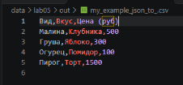

# ЛР5 — JSON и конвертации (JSON↔CSV, CSV→XLSX): Техническое задание
# Задание А — JSON ↔ CSV : модуль src/lab05/json_csv.py
# Функция json_to_csv

# Функция csv_to_json

# Задание B — CSV → XLSX
# Функция csv_to_xlsx

# Результат json -> csv

