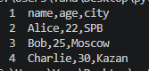
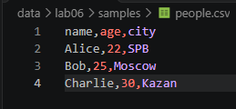
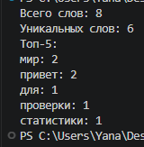
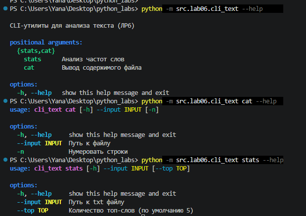
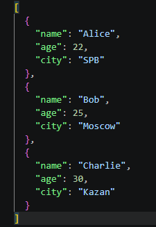
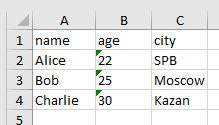

# Лабараторная работа №6
# CLI‑утилиты с argparse (cat/grep‑lite + конвертеры)

# cli_text 
```  python
import argparse
from pathlib import Path
from src.lib.text import normalize, tokenize, count_freq, top_n

def cmd_stats(args):
    path = Path(args.input)
    if not path.is_file():
        raise FileNotFoundError(f"Файл не найден: {path}")

    text = path.read_text(encoding="utf-8")
    tokens = tokenize(normalize(text))
    freq = count_freq(tokens)

    try:
        top = top_n(freq, n=args.top)
    except TypeError:
        top = top_n(freq)[:args.top]

    print(f"Всего слов: {len(tokens)}")
    print(f"Уникальных слов: {len(freq)}")
    print(f"Топ-{args.top}:")
    for word, count in top:
        print(f"{word}: {count}")

def cmd_cat(args):
    path = Path(args.input)
    if not path.is_file():
        raise FileNotFoundError(f"Файл не найден: {path}")

    with path.open("r", encoding="utf-8") as f:
        for i, line in enumerate(f, start=1):
            if args.number:
                print(f"{i:>6}\t{line}", end="")
            else:
                print(line, end="")

def main():
    parser = argparse.ArgumentParser(
        prog="cli_text",
        description="CLI-утилиты для анализа текста (ЛР6)"
    )
    subparsers = parser.add_subparsers(dest="command", required=True)

    # Подкоманда stats
    p_stats = subparsers.add_parser("stats", help="Анализ частот слов")
    p_stats.add_argument("--input", required=True, help="Путь к txt файлу")
    p_stats.add_argument("--top", type=int, default=5, help="Количество топ-слов (по умолчанию 5)")
    p_stats.set_defaults(func=cmd_stats)

    # Подкоманда cat
    p_cat = subparsers.add_parser("cat", help="Вывод содержимого файла")
    p_cat.add_argument("--input", required=True, help="Путь к файлу")
    p_cat.add_argument("-n", action="store_true", dest="number", help="Нумеровать строки")
    p_cat.set_defaults(func=cmd_cat)

    args = parser.parse_args()
    
    try:
        args.func(args)
    except FileNotFoundError as e:
        parser.error(str(e))

if __name__ == "__main__":
    main()
```  

1. **Подкоманда cat**

Назначение: Вывод содержимого указанного файла в консоль
```  python
python -m src.lab06.cli_text cat --input data/lab06/samples/people.csv -n
```
Терминал



 данные



2. **Подкоманда stats**

Назначение: Анализ частоты слов в текстовом файле

Команда запуска

``` python
python -m src.lab06.cli_text stats --input data/lab06/samples/people.txt --top 5
```
 данные
 


``` 
Привет мир! 
Привет мир.
Текст для проверки статистики.
```

**HELP**



# cli_convert
``` python
import argparse
from pathlib import Path
from src.lab05.json_csv import json_to_csv, csv_to_json
from src.lab05.csv_xlsx import csv_to_xlsx

def check_input(path_str):
    path = Path(path_str)
    if not path.is_file():
        raise FileNotFoundError(f"Входной файл не найден: {path}")
    return path

def cmd_json2csv(args):
    src = check_input(args.input)
    out_path = Path(args.output)
    out_path.parent.mkdir(parents=True, exist_ok=True) # Создаем папку, если нет
    json_to_csv(str(src), str(out_path))

def cmd_csv2json(args):
    src = check_input(args.input)
    out_path = Path(args.output)
    out_path.parent.mkdir(parents=True, exist_ok=True)
    csv_to_json(str(src), str(out_path))

def cmd_csv2xlsx(args):
    src = check_input(args.input)
    out_path = Path(args.output)
    out_path.parent.mkdir(parents=True, exist_ok=True)
    csv_to_xlsx(str(src), str(out_path))

def main():
    parser = argparse.ArgumentParser(
        prog="cli_convert",
        description="CLI-конвертеры данных (ЛР6)"
    )
    subparsers = parser.add_subparsers(dest="cmd", required=True)

    # json2csv
    p1 = subparsers.add_parser("json2csv", help="JSON -> CSV")
    p1.add_argument("--in", dest="input", required=True, help="Входной JSON")
    p1.add_argument("--out", dest="output", required=True, help="Выходной CSV")
    p1.set_defaults(func=cmd_json2csv)

    # csv2json
    p2 = subparsers.add_parser("csv2json", help="CSV -> JSON")
    p2.add_argument("--in", dest="input", required=True, help="Входной CSV")
    p2.add_argument("--out", dest="output", required=True, help="Выходной JSON")
    p2.set_defaults(func=cmd_csv2json)

    # csv2xlsx
    p3 = subparsers.add_parser("csv2xlsx", help="CSV -> XLSX")
    p3.add_argument("--in", dest="input", required=True, help="Входной CSV")
    p3.add_argument("--out", dest="output", required=True, help="Выходной XLSX")
    p3.set_defaults(func=cmd_csv2xlsx)

    args = parser.parse_args()
    
    try:
        args.func(args)
    except FileNotFoundError as e:
        parser.error(str(e))
    except ValueError as e:
        parser.error(f"Ошибка данных: {e}")

if __name__ == "__main__":
    main()
``` 
 # json2csv

 Команда запуска

``` python
python -m src.lab06.cli_convert json2csv --in data/lab06/samples/people.json --out data/lab06/out/people_converted.csv
``` 
Входные данные



Выходные данные


# csv2json
 Команда запуска

``` python
python -m src.lab06.cli_convert csv2json --in data/lab06/samples/people.csv --out data/lab06/out/people_converted.json

``` 
Входные данные


Выходные данные


# csv2xlsx
 Команда запуска

``` python
python -m src.lab06.cli_convert csv2xlsx --in data/lab06/samples/people.csv --out data/lab06/out/people.xlsx
``` 
Входные данные


Выходные данные



# НELP