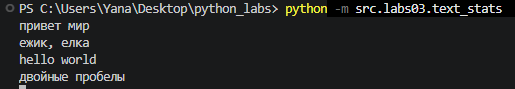
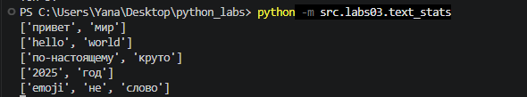
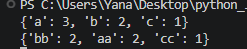
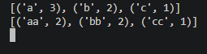

# ЛР3 — Тексты и частоты слов (словарь/множество)
# Задание A — src/lib/text.py
normalize
```python

```


tokenize
```python

```


count_freq
```python

```


top_n
```python

```


# Задание B — src/text_stats.py
```python

```
